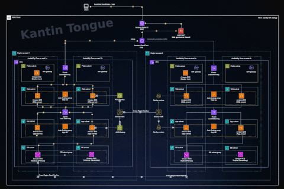

# Kantin Tongue — AWS Terraform + Jenkins, local state

## Architecture



This is the AWS version of the Azure three-tier warm-standby project. Jenkins checks out this repository, runs security scans, plans and applies Terraform, and smoke-tests the deployment. Terraform state is stored on the Jenkins agent's local disk; there is no S3 backend.

| Diagram | Terraform |
|---|---|
| Route 53 | `modules/dns` (optional, for a domain you own) |
| AWS WAF | `modules/edge`: managed common, known-bad-inputs and IP-reputation rules plus a rate limit |
| CloudFront (active / inactive) | `modules/edge`: origin group, primary first, fails over to the secondary on 5xx or timeout |
| VPC, 2 Availability Zones, public / web / app / DB subnets, NAT gateways | `modules/network` |
| Bastion host | `modules/bastion`: no inbound ports, reached through SSM Session Manager |
| External ALB, web Auto Scaling group, internal ALB, app Auto Scaling group | `modules/regional` |
| RDS primary + standby, cross-region replica | `modules/database`: PostgreSQL Multi-AZ, cross-region read replica |
| AWS Backup vault, cross-region backup copy | `modules/backup`: daily tag-based plan, copied to the secondary vault |

Defaults: primary region `us-east-1` (`10.10.0.0/16`), secondary region `us-west-2` (`10.20.0.0/16`). Both are variables.

Nothing has been deployed to AWS from this repository yet. See [Verification status](#verification-status).

## 1. Use one persistent Jenkins agent

Use an existing Jenkins installation or an Ubuntu 24.04 amd64 machine. Assign the label `terraform-local` to **only one persistent agent**: the Terraform state lives on its disk. The Jenkinsfile disables concurrent builds; local file locking cannot coordinate different machines.

If Jenkins is not installed, from a checkout of this repository run:

```bash
bash scripts/install-jenkins-ubuntu.sh
bash scripts/install-agent-tools-ubuntu.sh
sudo bash scripts/install-security-tools-ubuntu.sh
```

For an existing agent run only the last two scripts. They install Terraform 1.12.2 (checksum verified), AWS CLI v2, Gitleaks 8.30.1 and Trivy 0.75.0 (checksum verified).

Jenkins listens on localhost only. Open it through an SSH tunnel:

```bash
ssh -i /path/to/key.pem -L 8080:127.0.0.1:8080 YOUR_USER@JENKINS_HOST
```

Open http://localhost:8080, read `sudo cat /var/lib/jenkins/secrets/initialAdminPassword`, install the suggested plugins and create the administrator account. Make sure these plugins are installed: **Pipeline, Git, Credentials Binding, Timestamper, Pipeline: Input Step, HTML Publisher**.

## 2. Prepare local state storage

On the agent:

```bash
bash scripts/prepare-local-state.sh jenkins
```

| File | Purpose |
|---|---|
| /var/lib/jenkins/terraform-state/kt-aws-lab/infrastructure.tfstate | Workload state |
| /var/lib/jenkins/terraform-state/kt-aws-lab/bootstrap.tfstate | IAM bootstrap state |
| /var/lib/jenkins/terraform-state/kt-aws-lab/backups/ | Latest 20 workload-state snapshots |

Directories are mode 0700 and snapshots 0600. The `state-created` marker stops the pipeline if the state file disappears after a deployment. Back up this directory with your own process; snapshots on the same disk do not survive loss of that disk.

## 3. Bootstrap the Jenkins IAM user once

The bootstrap creates IAM user `kt-lab-jenkins` with:

- `PowerUserAccess` (everything except IAM), and
- an inline policy allowing IAM only on roles and instance profiles named `kt-lab-*`, and only with the three AWS managed policies this project attaches (SSM core, AWS Backup backup/restore). The pipeline cannot grant itself wider access.

Run it as the Jenkins OS account, with an **operator's administrator credentials**, then remove them:

```bash
sudo -u jenkins -H bash
umask 077
git clone https://github.com/kantinstephane10/3-Tier-app-DR-active-passive-webapp-AWS.git ~/bootstrap-kt-aws-lab
cd ~/bootstrap-kt-aws-lab
aws configure --profile kt-operator      # operator access key, temporary
export AWS_PROFILE=kt-operator
cp bootstrap/terraform.tfvars.example bootstrap/terraform.tfvars   # set account_id
terraform -chdir=bootstrap init
terraform -chdir=bootstrap plan -out=bootstrap.tfplan
terraform -chdir=bootstrap apply bootstrap.tfplan
rm -f ~/.aws/credentials ~/.aws/config
exit
```

Then in the IAM console: Users → `kt-lab-jenkins` → Security credentials → **Create access key** (use case: application running outside AWS). Copy the access key ID and secret access key. The key is created by hand so the secret never enters Terraform state.

## 4. Add Jenkins credentials

Manage Jenkins → Credentials → System → Global credentials → Add Credentials:

| Credential ID | Kind | Value |
|---|---|---|
| aws-access-key-id | Secret text | Access key ID of `kt-lab-jenkins` |
| aws-secret-access-key | Secret text | Secret access key of `kt-lab-jenkins` |
| aws-lab-tfvars | Secret file | Your completed `config.tfvars` (step 5) |

The Jenkinsfile binds the keys as `AWS_ACCESS_KEY_ID` / `AWS_SECRET_ACCESS_KEY`, which both Terraform and the AWS CLI read. Before planning, the pipeline checks that the keys belong to the `account_id` in `config.tfvars`, and every provider sets `allowed_account_ids`, so Terraform refuses to touch any other account. Rotate the access key regularly.

## 5. Fill deployment inputs

```bash
cp environments/lab/config.tfvars.example environments/lab/config.tfvars
ssh-keygen -t ed25519 -f ~/.ssh/kt-aws-lab -C 'Kantin Tongue AWS lab'
cat ~/.ssh/kt-aws-lab.pub
```

Set `account_id` and `ssh_public_key`. Upload the file as the `aws-lab-tfvars` credential and do not commit it (`.gitignore` excludes it).

Defaults: primary `m6i.large`, standby `t3.medium`, two instances per tier (max four), RDS `db.m6g.large` Multi-AZ, replica `db.t4g.medium` Multi-AZ. NAT gateways, ALBs, RDS, CloudFront, WAF and backups all cost money while they exist: price them before choosing APPLY.

## 6. Configure the Pipeline job

New Item → `aws-three-tier-lab` → Pipeline.

- **Pipeline script from SCM** → Git → `https://github.com/kantinstephane10/3-Tier-app-DR-active-passive-webapp-AWS.git`, branch `*/main`, script path `Jenkinsfile`.
- In the Git **Additional Behaviours**, do not enable shallow clone.

The Jenkinsfile's first stage clones the same repository and branch itself (`REPO_URL` / `REPO_BRANCH` at the top of the file), with full history for Gitleaks. You can also paste the Jenkinsfile into a plain Pipeline job; the checkout works the same way. If you make the repository private, add a read-only Git credential and put its ID in `REPO_CREDENTIALS`.

The first run loads the parameters. If **Build with Parameters** is missing, run **Build Now** once; the defaults are foundation / PLAN.

Stages: checkout → source and secret scans → local state check → AWS identity check → fmt / init / validate / `terraform test` / Python tests → plan → deletion check → plan scan → critical approval (APPLY only) → apply saved plan → smoke test → state snapshot and cleanup.

## 7. Review the security scan in Jenkins

Every build has a **Security Scan Report** link on the build page. It shows the counts per severity and a table of every finding: severity, phase (source or plan), tool, check ID (linked to its documentation), title, file, line, resource and the suggested fix. The same table is printed in Console Output, and the JSON reports are archived as build artifacts. Code snippets and secret values are never included.

LOW, MEDIUM and HIGH findings continue automatically. CRITICAL findings pause APPLY until a user in `SECURITY_APPROVERS` accepts the risk with a written justification. See [PIPELINE-SECURITY.md](docs/PIPELINE-SECURITY.md).

**Expect 6 CRITICAL findings on every run** (Trivy AWS-0104). They are the outbound security-group rules that let web, app and bastion instances reach the internet on ports 80 and 443 through the NAT gateways, for Ubuntu packages and the SSM agent. Review and accept them, or remove the need for them (see [SECURITY-AND-LIMITATIONS.md](docs/SECURITY-AND-LIMITATIONS.md)).

## 8. Roll out in cumulative stages

| ROLLOUT | Resources added |
|---|---|
| foundation | Primary VPC, subnets in two AZs, NAT gateways, security groups, bastion |
| primary | Primary ALBs, web/app Auto Scaling groups, RDS Multi-AZ, AWS Backup |
| dr | Secondary VPC and bastion, standby compute, cross-region RDS replica, secondary vault and cross-region backup copy |
| edge | WAF, CloudFront with primary → secondary failover, optional Route 53 domain |

For each stage run ACTION=PLAN, review Console Output and the Security Scan Report, then run the same ROLLOUT with ACTION=APPLY. APPLY makes and applies its own saved plan. Keep the highest deployed ROLLOUT selected afterwards: `scripts/check-plan.py` stops any plan that deletes or replaces a resource, including an accidental rollback to an earlier stage.

### What to check after each stage

**foundation**: VPC `vpc-kt-lab-primary` (`10.10.0.0/16`); subnets `public` 10.10.0-1.0/24, `web` 10.10.10-11.0/24, `app` 10.10.20-21.0/24, `db` 10.10.30-31.0/24; a NAT gateway per AZ; the DB subnets have no internet route. Connect to the bastion with `aws ssm start-session --target <instance-id>` (shown in the `bastions` output).

**primary**: both target groups healthy; two web and two app instances spread across the two AZs; the smoke test passes web → internal ALB → app. The RDS instance is Multi-AZ, not public, and its master password is in Secrets Manager (`database.master_user_secret_arn` output). From an app instance, `nc -vz <primary_endpoint> 5432` reaches the database. In AWS Backup, the plan `kt-lab-primary-daily` selects resources tagged `backup = kt-lab`; Auto Scaling instances carry that tag, so new instances are protected automatically.

The public ALB is not reachable from your browser: its security group only allows CloudFront's origin-facing ranges, and its listener returns 403 unless the request carries CloudFront's secret `X-Origin-Verify` header.

**dr**: the same layout in the secondary region (`10.20.0.0/16`), smaller instances, the read replica `kt-lab-replica` replicating from the primary, and the backup plan copying recovery points to `kt-lab-secondary-vault`.

**edge**: Jenkins prints `cloudfront_url`. Open it over HTTPS and expect JSON with owner Kantin Tongue and the primary region. `database_connected=false` is intentional: the demo app does not query the database.

## 9. Optional custom domain

Use a domain you own. Set `dns_zone_name` (and optionally `dns_host_label`, default `app`) in `config.tfvars` and re-upload it. Because the registrar delegation is outside Terraform, create the hosted zone first, on the state-owning agent with the Jenkins keys:

```bash
terraform -chdir=environments/lab plan -var-file=config.tfvars -var=stage=edge -target='module.dns[0].aws_route53_zone.this' -out=dns-zone.tfplan
terraform -chdir=environments/lab apply dns-zone.tfplan
terraform -chdir=environments/lab output dns_name_servers
```

Set those name servers at your registrar, wait for delegation, then run Jenkins edge PLAN/APPLY. ACM validates the certificate through Route 53, CloudFront gets the alias and certificate, and A/AAAA alias records point to the distribution. Never routinely deploy with `-target`.

## 10. Failover and restore drills

See [FAILOVER.md](docs/FAILOVER.md).

## 11. Costs and cleanup

Watch AWS Cost Explorer. Stopping instances does not stop charges for NAT gateways, ALBs, RDS, CloudFront, WAF, EBS and backup storage.

The pipeline has no destroy action on purpose. To remove the lab, use a separate trusted operator process on the state-owning agent: turn off RDS `deletion_protection` on both databases, decide what to do with recovery points in both vaults (vaults cannot be deleted while they hold recovery points), then plan and apply `terraform destroy` with the latest ROLLOUT and the same configuration. Keep both state files until everything is gone.

## Verification status

See [VALIDATION.json](VALIDATION.json). Checked on a workstation: `terraform fmt`, `validate` for both roots, `terraform test` building all four rollout stages and the custom-domain path against mocked AWS providers, cloud-init rendering, 12 Python tests, shell syntax, and a Trivy 0.75.0 source scan. **Not run:** a real AWS plan or apply, the Jenkins runtime, failover and restore drills.

## Official references

- Terraform AWS provider: https://registry.terraform.io/providers/hashicorp/aws/latest/docs
- Terraform tests and mocks: https://developer.hashicorp.com/terraform/language/tests/mocking
- CloudFront origin failover: https://docs.aws.amazon.com/AmazonCloudFront/latest/DeveloperGuide/high_availability_origin_failover.html
- RDS cross-region read replicas: https://docs.aws.amazon.com/AmazonRDS/latest/UserGuide/USER_ReadRepl.XRgn.html
- AWS Backup cross-region copy: https://docs.aws.amazon.com/aws-backup/latest/devguide/cross-region-backup.html
- Jenkins HTML Publisher: https://plugins.jenkins.io/htmlpublisher/
